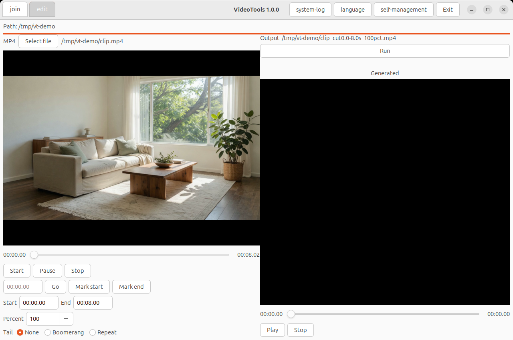
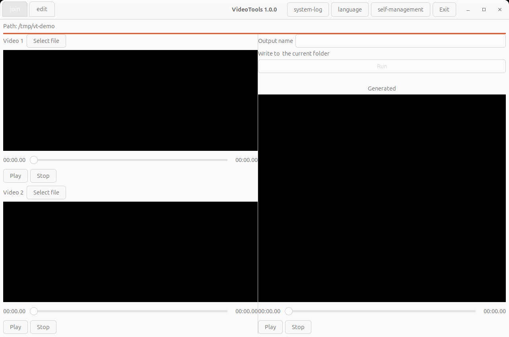

# cloud-video-editor - Join two local videos, and cut, speed, or boomerang an MP4.


[-purple.svg)](https://github.com/cloudgen/ciao)
[](https://github.com/cloudgen/cloud-video-editor)

cloud-video-editor joins two local videos, and it cuts, speeds, or boomerangs one MP4. The program is C++. `g++` is the compiler. On a terminal that has a display, a start with no words opens the picture window. FFmpeg does the encode. libmpv draws the picture inside the window.

You use it on your own files in the current folder. The program does not upload them.

| Box | Meaning | Example |
|-----|---------|---------|
| You | The person at the keyboard | You start cloud-video-editor with no words |
| The window | Edit and join | You pick files and press Run |
| Not the window | Typed verbs | `cloud-video-editor join` and `cloud-video-editor edit` stay on the terminal |

| Includes | Excludes |
|----------|----------|
| Two-file join, one-file cut, speed, and one tail | A Gemini page on a bare start, a second mpv window |

## Features

- Picture window for edit and join. Edit is the page you see first.
- Playback stays inside the panes. The program loads `libmpv.so.2` at runtime and does not link `-lmpv`.
- Join uses stream copy, then a re-encode. Edit cuts, changes length from 20 to 200 percent, and can append a boomerang or a repeat.
- Duration comes from `ffprobe`.
- With no display, or when standard output is not a terminal, a bare start shows the numbered menu. `tui` shows that menu.
- `--json` prints one object.
- `--gemini` opens the inherited WebKit shell. `log`, `luascript`, and `logcheck` keep that shell. `--window` is an error.

Edit, after a file is chosen:



Join, before any file is chosen:



## Quick Installation

Install GTK 3, WebKitGTK 4.1, SQLite, Lua 5.3, epoxy, and the libmpv headers. Put `ffmpeg` and `ffprobe` on `PATH`. The picture also needs `libmpv.so.2` on the loader path at runtime.

```bash
./build.sh build
./target/exe/debug/cloud-video-editor version
```

`./build.sh` reads `project.sh`. `./build.sh install` requests the apt packages and needs permission to install them. The same sources are listed in `meson.build` for a second build. Do not pass `-lmpv`.

On Windows cmd the same verbs run as a normal user. `ffmpeg.exe` and `ffprobe.exe` must already be on `PATH`. The program starts them with `CreateProcessW` and does not install them. The picture window is the same GTK window when that Windows build has GTK, libmpv, and a display. This checkout was compiled with `g++` on Linux.

With no display, on a terminal, a bare start shows this menu. `9` leaves.

```text
$ env -u DISPLAY -u WAYLAND_DISPLAY ./target/exe/debug/cloud-video-editor

1. join        : pick two videos in this folder and concatenate
2. edit        : cut, speed, and optional boomerang or repeat
3. list-videos : names that join can use
4. list-mp4    : MP4 names under a folder
5. help
6. about
7. version
9. Exit
>
```

`cloud-video-editor version` prints `cloud-video-editor 1.0.0`. The menu itself has no title line.

## Usage

```bash
cloud-video-editor
cloud-video-editor join --first a.mp4 --second b.mp4
cloud-video-editor list-videos
cloud-video-editor edit --file clip.mp4 --start 1 --end 5 --percent 50
cloud-video-editor edit --file clip.mp4 --start 1 --end 5 --boomerang
cloud-video-editor list-mp4
cloud-video-editor help
cloud-video-editor about
cloud-video-editor tui
cloud-video-editor --json version
```

A bare start with a display and both terminal sides opens the picture window. Choose Edit or Join at the top. Select file, then Run. Closing the window while a job is running waits until that job finishes.

Join looks only in the current folder. The suffixes are `.mp4`, `.mov`, `.mkv`, `.avi`, and `.m4v`. An empty output name becomes `{name1} + {name2}.mp4`.

Edit takes one MP4. Percent defaults to 100 and must be from 20 to 200. The tail is none, boomerang, or repeat. The result is written beside the source.

`--window` prints an error and does not open a window. `--gemini` alone opens the inherited shell.

## Examples

Cut the first five seconds and keep the original speed:

```bash
cloud-video-editor edit --file clip.mp4 --start 0 --end 5 --percent 100
```

Join two files in the current folder and name the result:

```bash
cloud-video-editor join --first a.mp4 --second b.mp4 --output reel.mp4
```

Ask for one JSON object:

```bash
cloud-video-editor --json version
```

## Platform Compatibility

| Platform | What works |
|----------|------------|
| Linux, GTK 3, a display, and `libmpv.so.2` | Picture window. Verified with `g++` on this checkout |
| Linux, no display, or standard output is not a terminal | Numbered menu and the typed verbs |
| Windows cmd | Typed verbs when `ffmpeg` and `ffprobe` are on `PATH`. Process start is `CreateProcessW`. The picture window is the same contract when that build has GTK, libmpv, and a display. This checkout was not compiled on Windows |

## Related Projects

- [FFmpeg](https://ffmpeg.org/) encodes the join and the edit.
- [mpv](https://mpv.io/) supplies libmpv, which draws inside the panes.
- The WebKit shell in this tree is the gemini-wilgat bootstrap. `--gemini` opens it.

## Contributing

Keep a bare start on the picture window. Keep `--gemini` on the inherited shell. Keep `--window` as an error. Do not link `-lmpv`. Match the sentences in `docs/requirements/requirement-cpp-gui.md` and `docs/requirements/requirement-cpp-windows.md`.

## License

MIT. See [LICENSE.md](LICENSE.md).

## Last Update

2026-10-14. Version 1.0.0. The picture window, the Windows process host, and the screenshots above are part of this version.
